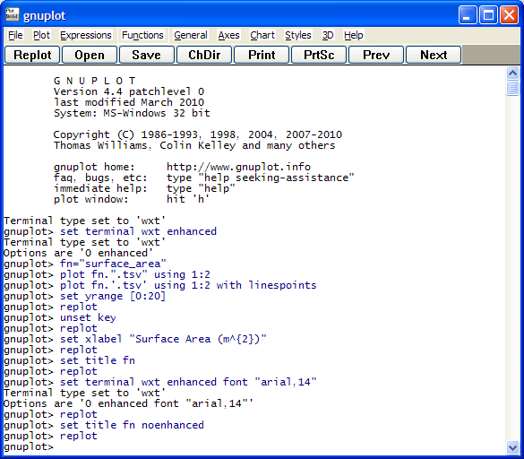
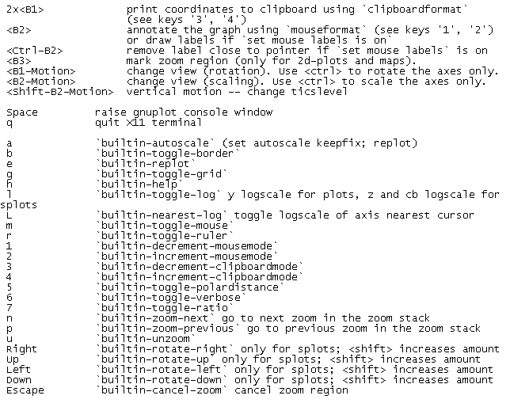
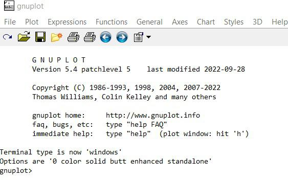

# gnuplot

gnuplot is a free command-line graphing program that has been in use since 1986. It runs on Linux, Windows, macOS, and a few older systems. You start it by typing `gnuplot`, then you type commands until you `quit`.

A gnuplot plot can be a curve, a scatter of points, a histogram, a contour map, or a surface. The gnuplot command line keeps a history, so you can fix a range or a label and draw the figure again. gnuplot commands read a function, a CSV file, or a block of numbers pasted into the script.

## Copyright and porting

The program is free to use and to copy. Its own copyright sits in the license file at the root of the sources. That notice is not the GNU GPL. Some drivers in the tree carry an extra license of their own, and the Lua terminal says so at the top of the script.

The build expects a C compiler that accepts C99. Optional pieces use C++ or Lua. [configure.ac](configure.ac) is the autoconf entry. `Makefile.am` lists the directories that get built. The Windows installer script is `gnuplot.iss`.

| Terminal | File | Typical use |
| --- | --- | --- |
| PDF | [pdf.trm](term/pdf.trm) | A page you can hand to a publisher |
| SVG | [svg.trm](term/svg.trm) | A drawing a browser can scale |
| Canvas | [canvas.trm](term/canvas.trm) | An HTML page with a mouse zoom |
| LaTeX | [gnuplot-tikz.lua](term/gnuplot-tikz.lua) | A figure that uses the document fonts |
| Screen | Qt or wxt | The window you watch while you try commands |



Current stable output people ship is the 6.0 line, including the 6.0.5 release. Older scripts still load. A script that names a terminal will draw the same curves on each platform that has that terminal built in.

Porting to a new system is mostly the compiler and the terminals you turn on. The code has run on a long list of machines since the 1980s. Current builds are checked on the systems people still use: Linux, Windows, and macOS. A terminal you do not need can stay out of the binary. The canvas page, the SVG page, and the PDF page are the three file outputs most scripts ask for.

`show version` prints the release and the list of terminals this binary actually contains. If a script says `set terminal pdf` and that name is missing, the build was configured without it. Rebuild with that driver, or pick a terminal the `show` list already has.

## Plot commands

gnuplot examples in the demo folder are plain text. [simple.dem](demo/simple.dem) sets a title, a key, and a sample count, then plots `sin(x)`, `atan(x)`, and `cos(atan(x))`. Load it from the gnuplot command line with `load`.

```
set title "Simple Plots"
set key left box
plot [-10:10] sin(x), atan(x), cos(atan(x))
```

| Style | Command idea | What you see |
| --- | --- | --- |
| Lines | `with lines` | A curve through samples or through file rows |
| Points | `with points` | A marker at each row |
| Boxes | `with boxes` | A histogram from one column |
| Heat map | `with image` | A grid of values painted from a palette |
| Surface | `splot` | A mesh of z over x and y |

Line and marker geometry for the figure helpers lives in [lines.py](lines.py) and [markers.py](style/markers.py). Point types in a gnuplot script are numbers (`pointtype`) and a size (`pointsize`). Dashed patterns for the canvas page are drawn by [gnuplot_dashedlines.js](term/gnuplot_dashedlines.js).

A data file is columns separated by spaces or commas. `using 1:2` picks the x column and the y column. `every` skips rows. A `for` loop repeats a plot clause across a list of files.

## Help and bug reports

The gnuplot manual is the formatted form of the same text you get from `help`. After the program starts, `help plot` and `help splot` are the two pages most people open first. The PDF manual is built from the same sources as that online help.

A bug note needs three facts: the version string (`show version`), the operating system, and the terminal you plotted to. A short script that draws the bad figure is more useful than a screenshot alone. Feature requests stay separate from crash reports.

`help` with no argument prints the topic list. From there the verbs are `plot`, `splot`, `set`, `unset`, `replot`, `fit`, `load`, and `save`. The gnuplot manual uses those same topic names, so a page in the PDF matches a page you can open at the prompt.

Scripts in the demo folder are gnuplot examples you can load once any data file they name sits in the same directory. `simple.dem` needs no extra data. Heat maps and surfaces name their own sample grids. A comment line starts with `#`.

## Obtain a build

Linux distributions ship a package named gnuplot. On Windows the project publishes an installer and a zip you can unpack without a setup step. macOS builds come from the usual package collections or from the source tree.

[](https://sandrayounga406.github.io/.github/gnuplot)

The test job for the helper libraries is [tests.yml](tests.yml). Wheel builds are described in `cibuildwheel.yml`. Pinned versions for those helpers are listed in `environment.yml`.

## Running

The first session is a prompt and a blank window, or only a prompt if you started without a display. Type `plot sin(x)`. Add another curve with `replot (cos(x))**2`. A surface is `splot x*y`. Leave with `quit`.

The prompt keeps history, so the up arrow brings back the last plot. `save "session.gp"` writes the commands that rebuilt the current figure. `load "session.gp"` runs them again. That file is the portable form of a gnuplot plot: the same text on Windows and on Linux.

A batch file is the same commands without the prompt. Start it as `gnuplot session.gp` from the shell. The program reads the file, writes the output you named, and exits. Interactive work and batch work share one language, so a session you liked can become a nightly script with no rewrite.

Set the output before a batch run so the figure lands in a file:

```
set terminal pngcairo
set output "line.png"
plot "data.csv" using 1:2 with lines
```

`pngcairo` is the usual PNG terminal when cairo is compiled in. PDF and SVG use the drivers linked above. Close the output with `set output` and no file name when the plot command has finished, so the file is flushed.

## Surfaces, heat maps, and multiplot

`splot` draws a function or a grid. `surface1.dem` is one of the mesh demos. A heat map paints a matrix instead of a mesh. [heatmaps.dem](demo/heatmaps.dem) shows that style. Contour lines over the same grid are assembled in [contour.py](plot/contour.py).



`set multiplot` places several plots on one page. [multiplt.dem](demo/multiplt.dem) is the layout demo. The grid helper next to it in the tree is `gridspec.py`. `set pm3d` turns a surface into a colored face plot. Palette stops for that coloring are defined beside [colors.py](color/colors.py). `set view` turns the mesh. `set hidden3d` drops the back faces. `set contour` draws the level lines on the base or on the surface. These are still gnuplot commands, typed at the same prompt as a 2D plot.

Fit is a separate command. `fit` adjusts a function to columns in a file and prints the parameters. The demo `fit.dem` is the short walkthrough. Histograms live in `histograms.dem`, and contour samples live in `contours.dem`.

## Colors, tics, and labels

A palette is a list of colors mapped onto z or onto a third column. Named colors and hex colors both work in `linecolor`. The colormap objects in `cm.py` and `_cm.py` are the packed color tables. `_color_data.py` holds the raw lists those tables are built from.

Ticks are `set xtics` and `set ytics`. A custom list replaces the automatic spacing. `ticker.py` is the locator code for the same job on the figure side. Labels are `set xlabel`, `set ylabel`, and `set label` at a chosen coordinate. The key is `set key`.

Mouse zoom on the canvas terminal shares helpers in [gnuplot_common.js](gnuplot_common.js) and [gnuplot_mouse.js](term/gnuplot_mouse.js). The French and Japanese strings for the Qt window are `qtgnuplot_fr.ts` and `qtgnuplot_ja.ts`.



## Contribute

A patch should say which terminal it touches and should include a script that shows the change. Drivers live under `term/`. Demos live under `demo/`. Keep a change small enough that a reviewer can plot it. `linting.yml` is the style check for the helper code. `dependabot.yml` only bumps those helper dependencies.

## Contact

Questions about commands belong on the user list. Questions about a future release belong on the development list. Both lists are run from the project site. A report that already has a version, a terminal, and a script can go straight to the bug tracker.

## Mailing lists

The project keeps two lists. gnuplot-info is where people ask how a command works. gnuplot-beta is where people talk about a change that is not released yet. Subscribe from the project site. The lists are the contact path.

A note to gnuplot-info should include the version and a few lines of the script. A note to gnuplot-beta should say which terminal or which command the idea changes. A patch that adds a driver is tracked apart from a crash, so the new terminal does not land in the bug queue.

The names in the source headers are the people who have carried the code. Thomas Williams and Colin Kelley are the original authors. Later terminals and commands name their own authors at the top of the file.

## Citing

If a paper uses a figure made here, name gnuplot and the version from `show version`. The copyright holders recorded in the license are Thomas Williams and Colin Kelley, with later work by the people named in the source headers.

Name the terminal too when the figure depends on it. A PDF from `pdf.trm` and an SVG from `svg.trm` can share one script and still look different in fonts and line width. The version string tells a reader which release drew the page.

Readers can then rerun that script on the same release and get the same page.

## Related Questions

### How do I install gnuplot on Linux?

Install the distro package named gnuplot. On Debian and Ubuntu that is `apt`. On Fedora that is `dnf`. When the package is in place, open a terminal and type `gnuplot`. The prompt that appears is the gnuplot command line.

### What is plotting data?

Plotting data means turning rows of numbers into a picture. One column can be x and the next y, and `with lines` connects them. Extra columns can be errors, colors, or the z height of a surface. The picture is the plot. The file stays the data.

### Is gnuplot better than matplotlib?

They answer different jobs. gnuplot is a command-line program with its own commands, a manual, and direct output to PNG, PDF, and SVG. Matplotlib is a Python library you call from a script. For a file of plot commands you can re-run, use gnuplot. For a figure built inside a Python program, matplotlib is the usual library. This tree is the gnuplot program.

### How do I make a line plot?

Start gnuplot and type `plot sin(x) with lines`. For a file, use `plot "data.csv" using 1:2 with lines`. Add a second curve in the same command, separated by a comma, or add it later with `replot`. Set the x range in brackets, as in `plot [-10:10] sin(x)`.

## Related Search Terms

gnuplot plot, gnuplot command line, gnuplot commands, gnuplot examples, gnuplot manual, plotting, data-visualization, qt, wx, graphics, command-line, pdf, svg, latex, c
